<div align="center">

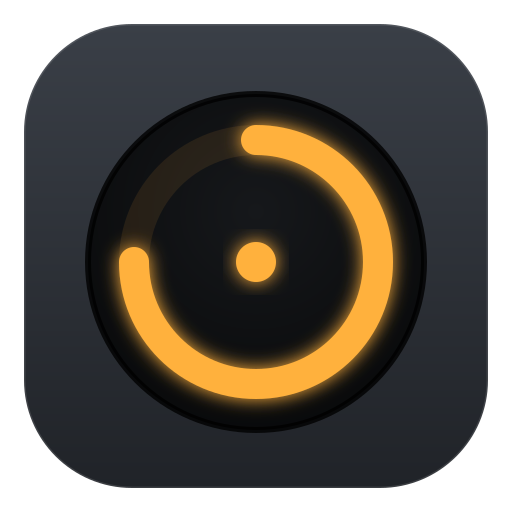

# App de Estudos

**App de desktop para Windows que transforma o plano de estudos em sessões de foco.**
Timer que conta para cima, meta do dia, bloqueio de Instagram, WhatsApp Web e jogos durante a sessão,
e uma IA que dá aula, monta simulado e corrige a resolução pela foto da folha.


</div>

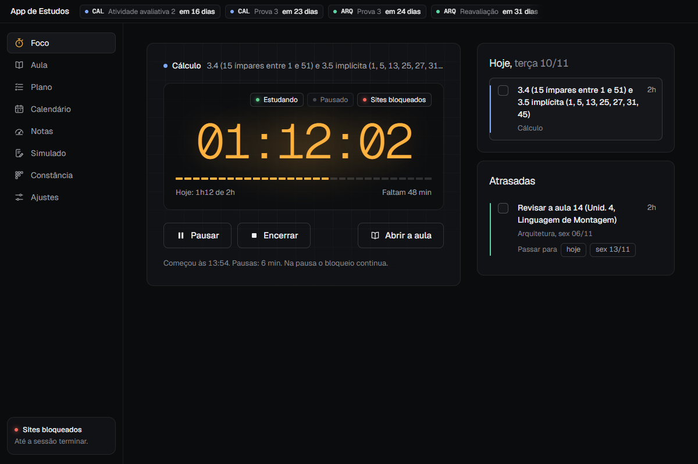

## Por que existe

Faço Engenharia de Software na PUC Minas e estudo à tarde no PC de casa. O problema nunca foi falta de plano: era
abrir o Instagram "só um minuto" e o Pomodoro, que não funciona comigo. Então o app junta o plano, o calendário de
provas e o timer num lugar só, e durante a sessão os sites e jogos simplesmente não abrem. Para parar antes da meta,
é preciso digitar uma frase com quantos dias faltam para a próxima prova da matéria. Colar não funciona.

## O que ele faz

### Sessão de foco

- **Timer que conta para cima**, ligado a uma tarefa do plano. Pausar não desbloqueia nada.
- **Meta do dia** = soma das horas previstas nas tarefas do dia.
- **Trava:** antes de bater a meta, encerrar pede a frase digitada, com a avaliação da matéria da sessão.
- **Bloqueio de sites e apps:** Instagram, WhatsApp Web e o que mais estiver na lista viram `0.0.0.0` no `hosts`.
  Um vigia fecha WhatsApp Desktop, Steam, Epic, Riot e qualquer jogo aberto das pastas deles.
- **Bloqueio agendado:** de segunda a sexta, das 13:50 às 18:00 (editável em Ajustes), o bloqueio liga sozinho, mesmo
  sem o timer. Só acaba antes do fim quando a meta do dia é batida, e em dia sem meta não liga.
- **Mini-timer** sempre por cima das outras janelas, **lembrete** que insiste a cada 15 min e **check-in** no fim
  (o que fez e onde travou).

<p align="center">
  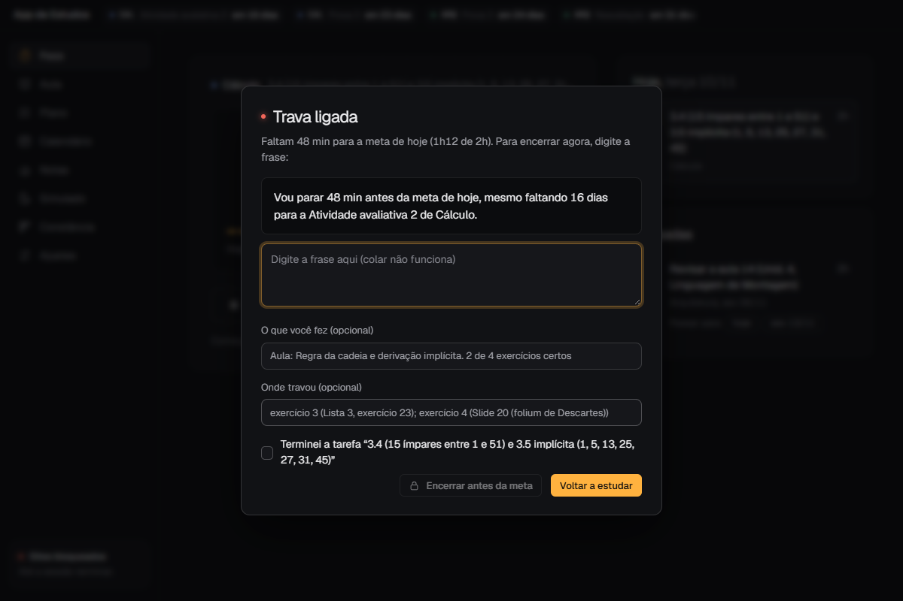
  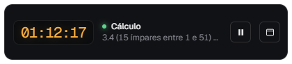
</p>

### Aula com a IA como professor

O app manda para a IA o tema da tarefa, a próxima avaliação, onde travei no último check-in e até 6 PDFs da matéria
(sugeridos do Canvas pelo nome). Ela devolve a ordem de estudo, as partes com fórmula e exemplo resolvido, as
armadilhas e de 5 a 10 exercícios com dica e gabarito escondidos. O gabarito só abre depois de uma tentativa. Embaixo
fica a conversa com o professor: mando a resposta escrita, falada (ditado do Windows) ou em foto, tirada na hora pela
câmera do PC ou do celular. Os números dos exercícios ficam presos no topo do chat: um clique mostra o enunciado ali, sem
subir a tela, e "Ver na aula" leva até a questão com um "Voltar ao chat" no canto. Ele corrige e marca o exercício.

<p align="center">
  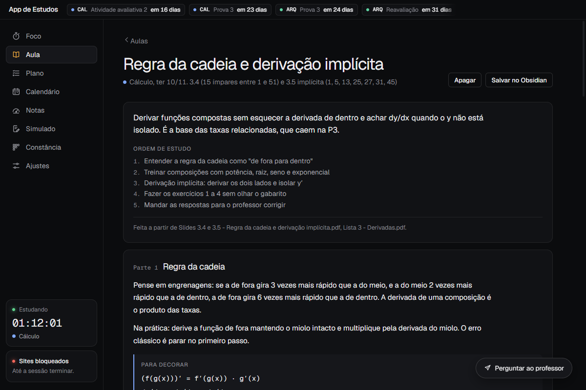
  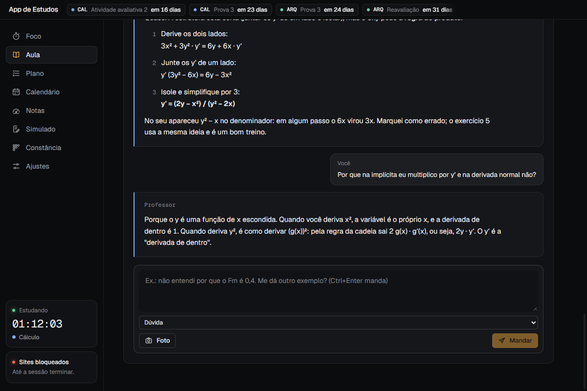
</p>

### Simulado com correção por foto

A IA monta a prova a partir do que cai na avaliação, com cronômetro. Resolvo no papel, arrasto as fotos da folha e
ela corrige questão por questão, dizendo o que acertei e onde errei. Os pontos fracos viram sugestões de tarefa.

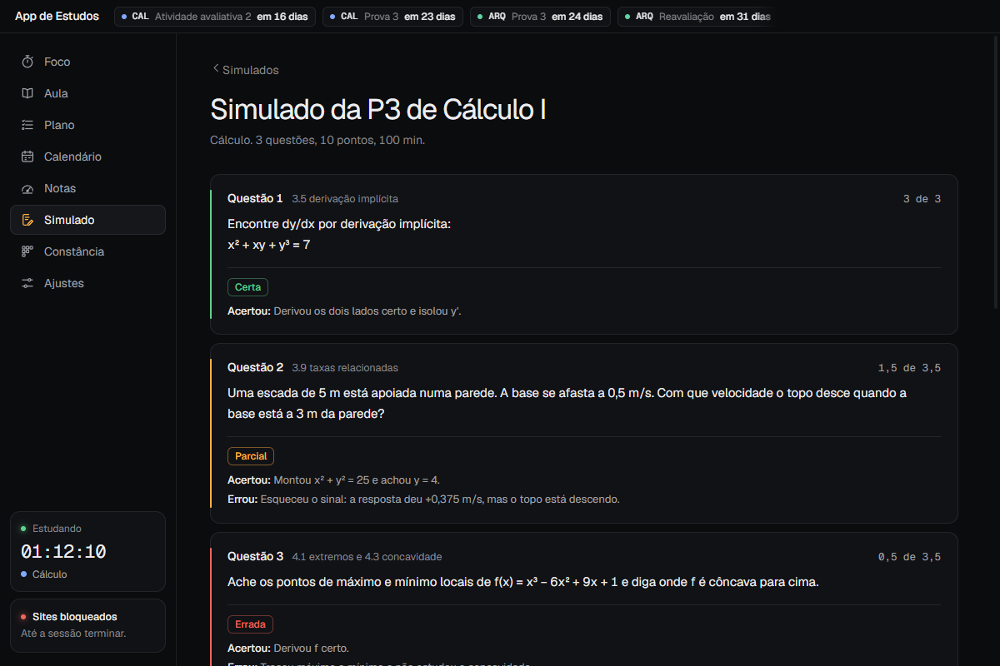

### Plano, calendário e Canvas da PUC

- **Plano por dia**, com botão para passar tarefas atrasadas e **replanejamento pela IA**, que mostra o antes e
  depois de cada mudança para eu marcar o que aplicar.
- **Calendário** com contagem regressiva das provas no topo de todas as telas.
- **Canvas da PUC** (API REST, só leitura): matérias, atividades, provas, notas e PDFs. Novidade passa por uma
  revisão, com "Juntar com" para não duplicar. O que já foi entregue sai dos avisos.
- **Leitura do PDF do plano de ensino** para montar o semestre, e **calculadora de nota** (quanto falta para 60).

<p align="center">
  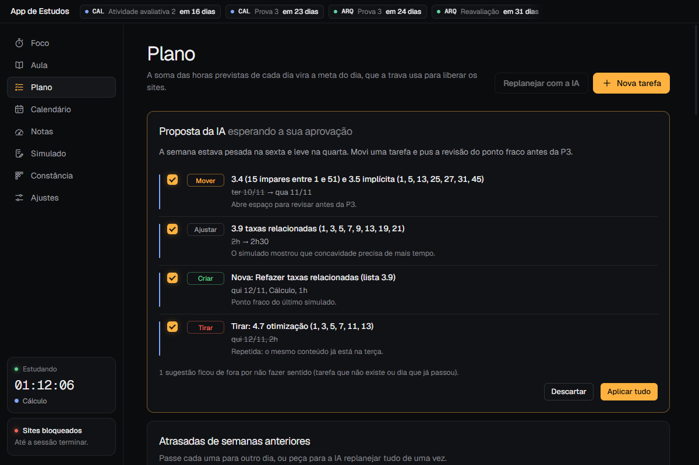
  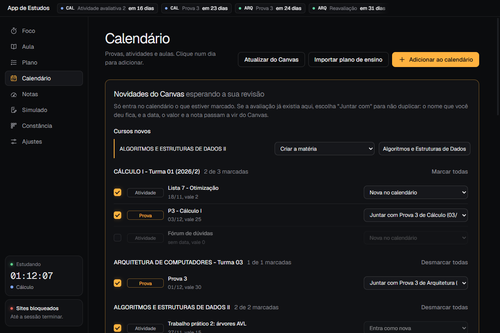
</p>

### Constância

Mapa de calor das horas por dia, sequência de dias com a meta cumprida (dia sem meta não quebra a sequência) e
planejado x feito por semana. O app também reescreve uma nota de resumo no meu vault do Obsidian.

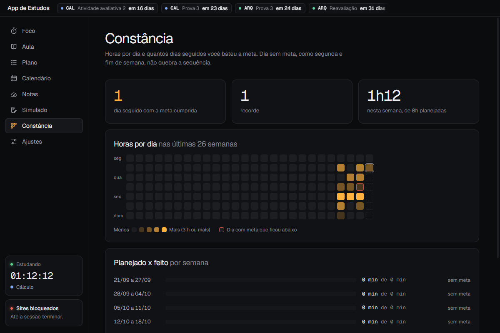

## Como funciona por dentro

### Bloqueio: o app pede, um serviço SYSTEM executa

O app roda como usuário comum e nunca mexe no `hosts`. Quem mexe é uma tarefa agendada que roda como SYSTEM,
instalada uma vez (o único pedido de administrador). Fechar o app não desbloqueia, e o bloqueio continua depois de
reiniciar o PC.

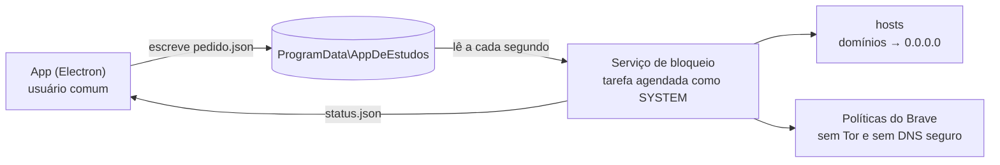

- **Falha fechado:** o serviço só libera com um pedido bem formado. Se o `pedido.json` sumir ou vier quebrado, o
  bloqueio fica como estava. E se o serviço não responder ao encerrar, o app avisa em vez de fingir que liberou.
- **Só domínios, sempre `0.0.0.0`:** o serviço valida cada nome antes de escrever, então o pedido não serve para
  redirecionar nada.
- **Listas que só crescem:** durante a sessão e o bloqueio agendado, as listas de sites e apps só aceitam acréscimos
  e a agenda não muda (garantido no processo principal, não só na tela).
- **Agenda e sessão juntas:** quem decide o horário é o app (`src/main/agenda.ts`), com o mesmo pedido ao serviço.
  Se a sessão termina antes da meta dentro do horário, o bloqueio continua. Durante o horário, o app não sai pela
  bandeja, para o vigia dos apps não parar.
- **Abas já abertas:** o `hosts` não derruba conexões abertas, então o app reinicia o Brave (e o Chrome) restaurando
  as abas. Enquanto bloqueia, o serviço desliga a janela com Tor e o DNS seguro, que furariam o `hosts`.

### IA pelo Claude Code, sem chave de API

Em vez de uma chave de API, o app chama o **Claude Code instalado no PC** (`claude -p`), usando a assinatura de quem
está logado. Cada tarefa roda numa pasta própria e em modo restrito.

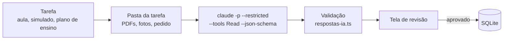

- A IA **só lê** a pasta da tarefa: sem comandos, sem MCP, sem editar arquivos. O app tira do ambiente as variáveis
  `CLAUDE*` e `ANTHROPIC*` (uma chave esquecida faria a chamada ser cobrada na API).
- A resposta vem num **JSON com schema** e passa por `src/shared/respostas-ia.ts`, que descarta o que não dá para
  aplicar (tarefa que não existe, data no passado, nota maior que o valor da questão).
- **Nada entra sem revisão:** o plano de ensino lido e o replanejamento aparecem com o antes e depois para aprovar.
- Uma tarefa por vez, com tempo limite e botão de cancelar. Cada uso fica registrado na tabela `ia_usos`.

### Decisões técnicas

| Decisão | Por quê |
|---|---|
| **sql.js** (SQLite em WebAssembly) | Sem módulo nativo para recompilar a cada versão do Electron. |
| Sessão salva como "acumulado até o marco + trecho desde o marco", com batimento de 30 s | Se o PC desligar, a sessão volta pausada contando só até o último sinal. Se o PC dormir, esse tempo não conta. |
| Regras puras em `src/shared` | Timer, meta, trava, notas e validação da IA são testados sem Electron. |
| Token do Canvas com `safeStorage` (DPAPI) | O token fica criptografado e só vai para a origem do Canvas: links de paginação ou download de outro servidor não levam o cabeçalho. |
| IA testada com um "claude" falso | Os testes rodam um script do Node no lugar do Claude Code, sem gastar nada. |
| Serviço testado de verdade | Os testes rodam o `.ps1` do serviço contra um `hosts` falso. |
| Cores em tokens CSS | A paleta inteira muda num bloco só do `estilos.css`. Fontes Geist e Geist Mono. |

<details>
<summary><b>Mais detalhes: Canvas, Aula, Simulado e o serviço</b></summary>

#### Canvas da PUC

O app lê o Canvas (`https://pucminas.instructure.com`, pela API REST v1) com um token pessoal que o aluno cria em
**Conta > Configurações > + Novo token de acesso** e cola em **Ajustes > Canvas da PUC**. Só leitura.

- **Token:** criptografado com o `safeStorage` do Electron no kv `canvas_token`. Não aparece em tela, log, resumo do
  vault nem mensagem de erro.
- **Sincronia:** 20 s depois de abrir e a cada 6 horas (ou em "Atualizar do Canvas", no Calendário). Busca os cursos
  ativos, as atividades de cada um (com a nota, quando publicada) e as provas do calendário.
- **Ligações:** kv `canvas_vinculos` (`curso:ID` → matéria, `tarefa:ID` ou `evento:ID` → evento; 0 = ignorado). O que
  já está ligado tem a data, o valor e a nota atualizados sozinhos. O que é novo vai para a revisão no Calendário.
- **Já entregue:** atividade enviada, corrigida ou dispensada não entra na revisão e sai dos avisos de cima, da trava,
  do resumo e do Simulado (coluna `eventos.entregue`). No Calendário ela fica riscada.
- **PDFs:** "Pegar do Canvas" no plano de ensino e "Material de aula do Canvas" no simulado e na aula. Quando o curso
  esconde a aba Arquivos, a lista vem dos módulos.
- Código: `src/main/canvas.ts` (cliente), `src/main/sincronia-canvas.ts` (sincronia e revisão),
  `src/shared/canvas.ts` (comparação, sem rede) e `src/renderer/src/componentes/Canvas.tsx` (telas).

#### Aula e Simulado

- **Aula:** tabela `aulas` (conteúdo, progresso e conversa em JSON). O material e as fotos ficam em
  `%APPDATA%\App de Estudos\aulas\<id>` para o professor reler nas perguntas. "Mais exercícios" foca nos errados, e
  "Salvar no Obsidian" grava a aula em Markdown no vault. O texto da IA aparece com passos, listas, negrito, expoente e
  índice (`src/shared/texto.ts` e `componentes/TextoRico.tsx`).
- **Na conversa com o professor:** uma barra presa no topo do chat (`position: sticky`) tem os números dos exercícios,
  com a cor de como foi cada um. O escolhido mostra o enunciado ali (com setas, dica e, depois de tentar, o gabarito), e
  "Ver na aula" guarda o ponto do chat para o "Voltar ao chat" do canto. O "exercício N" de cada mensagem abre o
  enunciado ali mesmo. Só as 4 últimas mensagens
  ficam abertas, e "Limpar conversa" apaga as mensagens e as fotos delas (as marcas dos exercícios ficam).
- **Câmera:** `componentes/Camera.tsx` usa o `getUserMedia` com a webcam ou o celular (iVCam), deixa conferir e juntar
  várias páginas, e o processo principal grava cada foto como arquivo (`src/main/camera.ts`) para seguir o caminho das
  fotos do PC.
- **Ditado:** o Electron não tem o reconhecimento de voz do Chrome, então o botão Falar usa o ditado do próprio Windows
  (Win+H). Como ele dita no idioma do teclado ativo, um PowerShell em segundo plano troca a janela para um teclado em
  português antes (`src/main/ditado.ts`). Sem português instalado no Windows, a tela explica como adicionar.
- **Simulado:** a resolução de cada questão fica escondida até a prova acabar. As fotos entram arrastando para a tela
  (JPG, PNG ou WEBP). A nota e os pontos fracos vão para o check-in e para o resumo do vault.
- **Login do Claude Code:** o Claude Code de linha de comando tem login próprio. Uma vez só, rode `claude auth login`
  num terminal e depois clique em **Ajustes > Testar**. O modelo padrão é o Opus, com o Sonnet como opção.

#### Serviço de bloqueio

- Script em `C:\Program Files\App de Estudos - Bloqueio`; pedido e status em `C:\ProgramData\AppDeEstudos`.
- Enquanto bloqueia, liga as políticas `TorDisabled` e `DnsOverHttpsMode=off` em
  `HKLM\SOFTWARE\Policies\BraveSoftware\Brave` (no Chrome, só a do DNS). Por isso o Brave mostra "gerenciado pela sua
  organização" durante a sessão.
- O script não muda quando o app é atualizado. Se o script novo for de outra versão (`$VersaoServico`), a tela
  Ajustes pede para clicar em **Reinstalar**.
- Com a sessão contando, o app pede ao Windows para não dormir sozinho (a tela ainda apaga).

</details>

## Stack

- **Electron 45** + **electron-vite 6** + **React 19** + **TypeScript**
- **SQLite** via **sql.js**, dados em `%APPDATA%\App de Estudos`
- **PowerShell** para o serviço de bloqueio e o vigia de apps
- **Claude Code** (`claude -p`) para a IA
- **Vitest** (111 testes) e **electron-builder** (instalador NSIS)

## Rodar

Precisa do Node 24 (`.nvmrc`). Com o nvm-windows: `nvm use 24.14.0`.

```bash
npm install
```

```bash
npm run dev
```

O bloqueio de verdade só liga depois de **Ajustes > Instalar o bloqueio** (o Windows pede administrador uma vez).

## Testes

```bash
npm test
```

Cobrem as regras (timer, meta, trava, lembrete), a calculadora de nota, o banco (inclusive a atualização de um banco
da v1.0), a sessão, o resumo do vault, o serviço de bloqueio (rodando o `.ps1` de verdade contra um `hosts` falso), o
vigia de apps (com `ping` no lugar de um app real), a comparação com o Canvas, a validação das respostas da IA, a aula, o
replanejamento, a virada de semestre e a constância.

Prints de todas as telas, sem tocar no bloqueio nem nos seus dados (os desta página saíram assim):

```bash
npm run build && npx electron . --dados=%TEMP%\estudos-teste --captura=%TEMP%\capturas --agora=2026-11-10T15:12 --captura-sessao --captura-ia --captura-trava
```

`--captura-ia` põe dados de mentira (simulado corrigido, aula de Cálculo, proposta de replanejamento, novidades do
Canvas e três semanas de estudo). Na captura, a câmera da Aula mostra a imagem de teste do Chromium no lugar da webcam.

### Vídeo

Um vídeo de demonstração com legendas, passando por todas as telas (inclusive uma nota lançada ao vivo em Notas) com
matérias, notas e plano fictícios (`src/main/demo-ficticia.ts`). O app grava a própria janela a 60 quadros com o
`MediaRecorder` do Chromium, sem programa de fora (o roteiro fica em `src/main/video.ts`). Os mesmos dados fictícios
servem para prints: `--ficticio` junto com `--dados` numa pasta vazia.

```bash
npm run build && npx electron . --dados=%TEMP%\estudos-video --agora=2026-11-10T15:12 --video=%TEMP%\gravacao.bin
```

A janela não pode ficar coberta durante a gravação. O arquivo sai em MP4 ou WebM, conforme o Chromium deixar, em
1920x1032; o ffmpeg converte, completa até 1080, suaviza o movimento (`fps=150,tmix=frames=3:weights='1 2 1',fps=60`)
e põe a capa no começo e no fim.

## Gerar o instalador

```bash
npm run instalador
```

Sai em `dist/App-de-Estudos-<versão>-instalador.exe`. Instalar por cima atualiza e mantém os dados.

## Estrutura

| Pasta | O quê |
|---|---|
| `src/shared` | Tipos e regras puras (timer, meta, trava, lembrete, notas, constância, validação das respostas da IA, resumo do vault) |
| `src/main` | Processo principal: banco (sql.js), sessão, bloqueio, lembrete, Canvas, IA (`claude.ts`, `assistente.ts`, `prompts.ts`, `planejamento.ts`), janelas e bandeja |
| `src/preload` | Ponte segura entre as telas e o processo principal |
| `src/renderer` | Telas em React: Foco, Aula, Plano, Calendário, Notas, Simulado, Constância, Ajustes e o mini-timer (Ctrl+1 a Ctrl+8 trocam de tela) |
| `servico` | Scripts PowerShell do serviço de bloqueio (instalar, rodar, desinstalar) |
| `testes` | Testes com Vitest |

## Versões

| Versão | Data | O que entrou |
|---|---|---|
| 1.0 | 08/11/2026 | Núcleo: timer, plano, calendário, trava e bloqueio de sites e apps |
| 1.1 | 08/11/2026 | Calculadora de nota, check-in e tarefas atrasadas; visual novo (Geist + âmbar) e bloqueio no Brave |
| 1.2 a 1.4 | 08 a 10/11/2026 | IA pelo Claude Code (simulado, plano de ensino, replanejamento), Constância e Canvas da PUC |
| 1.5 | 10/11/2026 | Aula com a IA como professor, sigla da matéria e atalhos |
| 1.5.1 | 11/11/2026 | PC dormindo não conta, bloqueio que falha fechado, atividades entregues fora dos avisos |
| 1.6 | 11/11/2026 | Bloqueio agendado (seg a sex, 13:50 às 18:00); na Aula, enunciado junto do campo, limpar conversa, câmera ao vivo e ditado |
| 1.6.1 | 11/11/2026 | Aula: barra dos exercícios presa no topo do chat e "Voltar ao chat" depois de ver a questão |

## Limites conhecidos

- Não bloqueia o celular, e uma VPN ou proxy passa por cima do `hosts`.
- Quem tem administrador no PC consegue desfazer o bloqueio. A trava serve contra o impulso, não contra a decisão de
  parar.
- A nota do simulado é uma estimativa: a IA pode errar conta ou ler mal a letra. A tela diz isso e mostra o que ela
  considerou certo e errado.
- Feito para a minha rotina: o plano inicial, as matérias e o Canvas são os da PUC Minas.

Especificação completa e decisões em [ESPECIFICACAO.md](ESPECIFICACAO.md).
